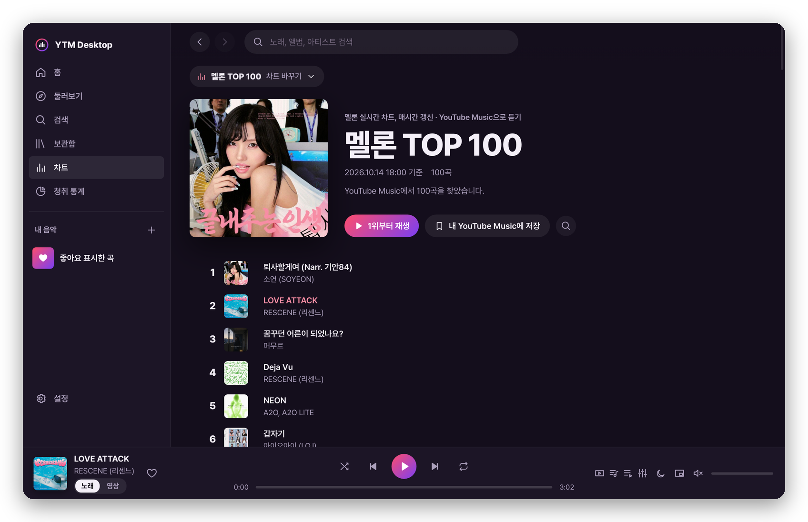

# YTMusic

**English** · [한국어](#한국어)

An unofficial music player for your YouTube Music account — desktop (macOS · Windows) and iOS, managed in one repository. Formerly called YTM Desktop.

**Download**: [Latest release](https://github.com/hanseihee/ytm/releases/latest) — macOS (Apple silicon) `.dmg` and Windows (64-bit) installer. Release notes are in [CHANGELOG.md](CHANGELOG.md) (Korean).



## English

- **YTMusic** (macOS · Windows): Rust (Tauri 2) + React
- **YTMusic** (iOS): native SwiftUI screens + the same TypeScript data code as the desktop app (run in JavaScriptCore)

The screens are a player built from scratch; the sound comes from the official YouTube Music web player running in a hidden web view.
Both apps share the same code for parsing YouTube Music responses, matching chart songs, finding lyrics, and the playback engine script.

### Features

- **Search**: songs, albums, artists, and playlists, with suggestions and type filters that keep loading more results.
- **Home**: YouTube Music recommendation shelves, loading more as you scroll.
- **Explore**: new releases, YouTube Music charts (14 countries including Korea, global, US, and Japan), and moods & genres. Album, artist, and playlist pages; artist pages show top songs, albums, singles, videos, and similar artists, and you can subscribe or unsubscribe.
- **Library**: Playlists · Albums · Artists · Subscriptions · Recently played (your account history).
  - Create playlists (with privacy), rename, edit the description, delete, add and remove songs, and drag to reorder.
  - YouTube Music's suggested songs appear under your own playlists; add them with +.
  - Save albums and playlists to your library.
- **Playback**
  - Picking a song starts its mix; songs in an album or playlist play within that list.
  - Play next and add to queue (whole albums too).
  - Now-playing tabs: Up next (queue and autoplay), Related, and Comments (20 at a time).
  - Shuffle, repeat, volume, seeking, a sleep timer (5 minutes–2 hours or end of the current song, fading out over the last 10 seconds), and link sharing.
- **Song ↔ video**: songs that have a music-video counterpart switch with `[Song | Video]`. YouTube Music aligns the two versions (e.g. the "Through the Night" music video starts 24 seconds later), and the lyrics carry over without reloading.
  - Desktop: a video window (rounded video on a dark backdrop with an ambient glow in the video's colors, optional always-on-top).
  - iOS: the cover and the video cross-fade in the same spot on the now-playing screen, and the background follows the video's colors. Landscape full screen (button or rotate the phone) and Picture in Picture.
  - Black bars baked into cinema-ratio music videos are detected and cropped.
- **Lyrics**: YouTube Music's own lyrics for the song are the reference. Time-synced lyrics (LRCLIB and Bugs synced lyrics; Bugs first for Korean songs) are used only when their text matches YouTube's, so another song's lyrics (or a different-language version) never show up; they highlight the current line, and clicking a line seeks to it. Otherwise YouTube Music's lyrics are shown as-is (no timing), and when YouTube has none the synced lyrics are the fallback. Text size 70–175% (A−/A+ or ⌘= ⌘- ⌘0), per-song sync adjustment in 0.5 s steps (remembered). On desktop you can choose to show the lyrics or the album art large; under the large album art a live spectrum (bass on the left, vocals in the middle, treble on the right — the same bars as the equalizer panel) moves with the music in the album's colors (on macOS only once audio capture is allowed — the cover view never asks for it). **Full screen mode** (the corners button in the lyrics view) is made for leaving on a monitor: a large cover, album, title, artist, three lyric lines and the spectrum over a blurred cover background; the cursor and controls hide after 3 seconds, Esc exits, and on macOS the display stays awake while it is open. iOS can translate lyrics with the system translator.
- **Listening stats**: from songs played on this device for over 30 seconds (or over half of a short song): listening time, a daily bar chart, and top songs and artists (7 days · 30 days · 1 year · all time).
- **Languages**: Korean, English, Japanese, Simplified Chinese, Traditional Chinese, Spanish, Portuguese (Brazil), French, German, and Indonesian — chosen in Settings (or follow the system), applied right away including the macOS menus and tray. Song and shelf names from YouTube Music follow your account language.
- **Update notice** (desktop): on launch the app checks the latest GitHub release and offers to open the download page when a newer version is out ("Later" hides it until the next version).
- **Themes**: System, Dark (default), Light, Midnight, Forest, Sunset, Mono, Sakura, and Album colors (Settings ⌘, or the macOS View → Theme menu). The window title bar follows the theme.
- **Small windows**: down to 720×560.
  - When the center area gets narrow, the cover moves above the title and track-list columns shrink.
  - In a narrow window the sidebar shows icons only, and the queue and EQ panels float over the content.
  - The player bar hides the volume slider and shuffle/repeat depending on width.
- **76 charts**
  - Melon (real-time, daily, weekly, monthly, and 25 genres), Genie TOP 200, Bugs, FLO, VIBE (today, domestic rising, overseas rising), Circle Chart, Spotify Top 50 in 20 countries, Billboard Hot 100, and Apple Music in 19 countries, grouped by source in the picker.
  - Each chart song is matched to a YouTube Music track automatically, and you can play from #1.
  - "Save to my YouTube Music" creates or updates a private playlist; you can also open any public Spotify playlist link.
- **Equalizer**: 10-band EQ (32 Hz–16 kHz) with preamp and 10 presets, showing the response curve and a live spectrum.
- **OS integration**
  - macOS Now Playing and media keys; Windows media controls (SMTC).
  - Tray menu; music keeps playing when the window is closed. Korean menus on macOS.
  - Mini player window (always on top): two lines of the current lyrics next to the cover, an up-next list that expands below (click a song to jump to it; drag the handle to change its height), and a seekable progress bar. A notification when the song changes while you're not looking at the app, and the album-color theme.

Shortcuts: Space (play/pause), ⌘/Ctrl+←→ (previous/next song), Shift+←→ (±10 s), ⌘/Ctrl+F (search), ⌘/Ctrl+L (lyrics), ⌘U (queue), ⌘/Ctrl+E (equalizer), ⌘/Ctrl+[ ] (back/forward)

Global shortcuts (work while using other apps; can be turned off in Settings): ⌃⌥ / Ctrl+Alt + P play/pause, N next, B previous, L like, M mini player

There is no ad blocking, audio downloading, or bypassing of paid features. The app never extracts stream URLs; it uses the official player as is.

### iOS app (`ios/`)

The same features on iPhone and iPad. The screens are new SwiftUI (iOS 26+, glass tab bar with a mini player above the tabs), and the data layer runs the desktop code (`src/lib`) unchanged in JavaScriptCore, so results match.

- Tabs: Home · Explore · Charts · Library · Search (Settings is the gear at the top right of Home and Library).
- Now playing (inspired by Apple Music, Spotify, Melon, and the YouTube Music app): opens by expanding from the mini player and closes by dragging down. The background is painted with colors from the cover, with two lines of the current lyrics under the cover (tap for full lyrics).
  - A thin progress bar (thicker while dragging), shuffle · previous · play · next · repeat, and Lyrics · AirPlay · Queue (Up next · Related · Comments) at the bottom.
  - ⋯ menu: share a link, share an image card, sleep timer, and song actions.
  - Full lyrics: time-synced, tap a line to seek, text size 70–175%, ±0.5 s sync, translation.
  - Video mode: `[Song | Video]`, Picture in Picture, landscape full screen (tap for controls, hidden after 3.5 s).
- Home Screen and Lock Screen widgets (now playing: cover, title, previous/play/next), and Shortcuts/Siri (play/pause, next/previous song, play liked songs, sleep timer, open charts).
- Long-press or ⋯ on songs and cards: play, play next, add to queue, start mix, like, add to playlist, go to album or artist.
- Swipe rows: right to play next, left to add to queue (remove in your own playlists).
- Lock Screen and Control Center info (with artwork) and buttons, background playback (audio background mode).
  - WebKit, which produces the sound, publishes the Lock Screen info itself, so on iOS the engine forwards the captured `mediaSession` data (track info, artwork, previous/next actions) to the real `mediaSession` (without this, the artwork was missing).
- The same 8 themes and lyric text sizes as the desktop app.

**Not available on iOS: the equalizer.** The YouTube player's audio comes from WebKit's ManagedMediaSource, and routing it into Web Audio yields silence (simulator test, 2026-10-14). The Mac works around this with a system audio tap, which iOS does not offer.

**TestFlight (public beta)**: install from https://testflight.apple.com/join/g27zcffB with the TestFlight app (the link opens once Apple's beta review passes).

Build and install from source:

```sh
npm install
npm run ios:project        # data bundle (ios/build/ytm-core.js) + Xcode project (xcodegen)
open ios/YTM.xcodeproj     # pick your iPhone in Xcode and run (automatic signing; set your own team in ios/project.yml)
```

### Install

Download from [GitHub Releases](https://github.com/hanseihee/ytm/releases).
- macOS (Apple silicon): `YTMusic-<version>-mac-arm64.dmg`
- Windows (64-bit): `YTMusic-<version>-windows-x64-setup.exe`
- Verify downloads with `SHA256SUMS.txt`.

The apps are not signed with a paid developer certificate (macOS: ad-hoc signed, not notarized).
- **macOS**: open the DMG and drag **YTMusic** onto the **Applications** folder next to it (not the disk icon). The first time you open it, macOS says it "could not verify" the app — click **Done**, then go to System Settings → Privacy & Security, scroll down to Security and click **Open Anyway** next to "YTMusic was blocked", and confirm. You only do this once per version. (Terminal alternative: `xattr -dr com.apple.quarantine /Applications/YTMusic.app`)
- **Windows**: if SmartScreen warns you, choose "More info → Run anyway".

On first launch you'll see a "Sign in with your Google account" screen.

**macOS equalizer permission**
- The first time you turn it on, macOS asks for "System Audio Recording" permission. The app only processes the sound it plays itself; nothing is recorded or saved.
- If you deny it, the app detects that and returns to normal audio. You can allow it later in System Settings → Privacy & Security → Screen & System Audio Recording.

### Project layout

```
src/                      Desktop screens (React + TypeScript) and shared data code
  lib/ytm/parse.ts        YouTube Music (InnerTube) responses → tracks, cards, shelves
  lib/ytm/client.ts       Search, browse, library, playlist editing, playback requests
  lib/spotify.ts          Chart list, chart song ↔ YouTube Music matching (title/artist/duration score), save as playlist
  lib/charts/             Parsers for the 76 charts (Melon, Genie, Bugs, FLO, VIBE, Circle, Billboard, Apple Music)
  lib/melon.ts            Melon TOP 100 page parser (shared by desktop and iOS)
  lib/stats.ts            Listening stats (this device)
  platform/jsc/           iOS data-bundle entry: app (Swift) bridge instead of the Tauri API; fetch/storage/timers for JavaScriptCore
  lib/lyrics.ts           Time-synced lyrics (LRCLIB, Bugs) + YouTube Music lyrics
  lib/update.ts           New-version check against GitHub releases
  i18n/                   Translations: Korean source text as keys, locales/<lang>.json, rust.ts (macOS menu strings), TRANSLATING.md
  lib/eq.ts               EQ settings, presets, response curve
  lib/theme.ts            Theme list and application (colors live in styles.css :root[data-theme])
  views/ components/      Screens (home, search, album, artist, playlist, library, charts, lyrics, queue, EQ, settings)
design/                   App and menu-bar icon sources (SVG, rendered to 1024 px with headless Chrome)
src-tauri/src/
  engine.js               Script injected into the hidden YouTube Music window (internal API, playback, queue, state, Windows EQ)
  engine.rs               Request/response relay between the screens and the engine window
  spotify.rs              Reads track lists from Spotify's public embed pages
  charts.rs               Fetches chart pages (allow-listed chart sites only; parsing in lib/charts)
  desktop.rs              Video window, mini player, song notifications, global shortcuts
  eq.rs                   EQ filter math (shared) and commands
  mac_tap.rs              macOS EQ: Core Audio process tap
  media.rs                macOS Now Playing / Windows SMTC
  lib.rs                  Windows, tray, menus, startup
ios/                      iOS app (SwiftUI). project.yml → xcodegen
  YTM/Core/Engine.swift   Hidden WKWebView (music.youtube.com as desktop Safari) + engine.js requests/responses
  YTM/Core/JSCore.swift   Runs the shared data code in JavaScriptCore
  YTM/Core/ChartPages.swift  Fetches Spotify embeds and chart pages (same allow list as charts.rs)
  YTM/Core/NowPlayingCenter.swift  Lock Screen / Control Center, writes track info for the widget
  YTM/State/AppModel.swift Playback, library, navigation, settings, sleep timer, full-screen state
  YTM/State/Intents.swift  Shortcuts and Siri
  YTM/Views/              Home, Explore, Search, Charts, Library, Stats, Settings, Album, Artist, Now playing (video, full screen)
  YTMWidget/              Home Screen / Lock Screen widget (App Group group.dev.seihee.ytmmobile)
  Shared/                 Shared by the app and the widget (now-playing info, widget button actions)
```

### How it works (analyzed and tested 2026-10-14)

1. **Authenticated internal API calls**: the engine script calls `/youtubei/v1/…` from inside the signed-in music.youtube.com page.
   - The `SAPISIDHASH <seconds>_<sha1(seconds SAPISID origin)>` authorization is built the same way the YouTube Music scripts do it, along with the 1P/3P cookie variants.
   - Tokens from the page context that expire (`consistencyTokenJars`) are removed.
   - If a request fails with 400 right after launch, it is retried shortly after.
2. **Playback**: like YouTube Music's own components, it dispatches `yt-navigate` events carrying `watchEndpoint`/`watchPlaylistEndpoint`.
   - A single song starts as its mix (`RDAMVM…`); sending a bare videoId got inserted into the previous session's queue, so the "current song" went out of sync.
   - If the loaded song is paused, playback is resumed.
   - The song switches immediately but the new queue fills a moment later (the queue is empty in between), so the engine waits until the queue is filled and the song is the current item. Without this, picking #1 on a chart started from #2 (reproduced and fixed on 2026-10-14).
3. **Queue**: uses the Redux store attached to `<ytmusic-player-queue>` (`getState().queue`).
   - Read: `items`, `automixItems`, `selectedItemIndex`.
   - Play next: same as YouTube Music — fetch track data with `music/get_queue`, then dispatch `ADD_ITEMS`.
   - Jump: dispatch `SET_INDEX`.
4. **Track info and media keys**: the `navigator.mediaSession` the player fills in is swapped for an app-owned object (on iOS it is also forwarded to the real mediaSession).
   - Song ↔ video: clicks `<ytmusic-av-toggle>` and reads the time offset between versions from `counterpart[0].segmentMap` of the queue item's `playlistPanelVideoWrapperRenderer`.
   - Video view: hides the whole page with `visibility: hidden !important` and re-enables only the video boxes (to cover elements YouTube Music marks visible itself), then places the player where needed. The ambient glow blends video frames into a 48×27 canvas at 18% per frame and blurs it.
5. **Equalizer**
   - In the macOS WKWebView, routing the YouTube player's (MSE) audio into Web Audio produced silence (only the playback position moved). So on macOS it uses a Core Audio process tap (macOS 14.2+): it taps only this app's web-view process and mutes the original output, then Rust applies 10-band filters and soft clipping, plays to the default output device, and computes the spectrum with an FFT.
   - Windows (WebView2/Chromium) uses Web Audio in the engine page (`createMediaElementSource` → filters → analyser).
   - In both cases, if there's no signal right after connecting, it returns to normal audio and turns the EQ off.
6. **Charts**
   - Melon: reads rank, title, artist, cover, and timestamp from the chart page (`www.melon.com/chart/index.htm`). Melon has no durations, so matching uses title and artist scores only.
   - Spotify: since 2024-11-27 the Spotify Web API no longer opens editorial playlists to new apps, so tracks are read from `__NEXT_DATA__` of the public embed page (`open.spotify.com/embed/playlist/<id>`).
   - Matching first tries the "All" search results; if unsure, it searches again with that response's "Songs" filter (the filter value differs per query).
   - "Songs" results include durations, which separate songs whose English and Korean titles differ.
7. **Lyrics**: YouTube Music's web lyrics (browse `MPLY…`) carry no timing, even when signed in, so time-synced lyrics come from LRCLIB and from Bugs synced lyrics (`/search/track?q=` → `/player/lyrics/T/<trackId>`, fetched through the app's allow-listed fetch). A synced result is used only if at least 55% of its character trigrams also appear in YouTube's lyrics (`lyricsOverlap`); on 200 songs from a real listening history the same song mostly scored 0.8 or more and mismatched pairs at most 0.44.

### Build

```sh
npm install
npm run dev          # development
npm run build:mac    # .app + .dmg
npm run build:win    # cross-build the Windows installer on a Mac (needs cargo-xwin, makensis, llvm)
npm run version:set -- 0.3.0   # bump the version everywhere (desktop and iOS) + new CHANGELOG.md entry
npm run release      # build macOS and Windows → tag v<version> → upload installers and SHA256SUMS to a GitHub release
npm run check:parsers -- <response folder>   # check parsers against saved responses
node scripts/i18n-keys.mjs --write   # collect UI strings into src/i18n/keys.json and report missing translations
cd src-tauri && cargo test --lib       # EQ filter and Spotify parsing unit tests
```

Test hooks in development builds only (not in releases):
- `YTM_SELFTEST=<list.json>`: sends engine requests in order after launch and writes the responses to files.
- `YTM_DEBUG_DIR=<folder>`: runs `in/*.json` requests and writes answers to `out/`; `debugEval` can inspect the page.

### Release process

1. Bump the version with `npm run version:set -- <version>`.
2. Fill in the new entry in `CHANGELOG.md`.
3. Commit and push.
4. Run `npm run release` (`-- --skip-build` if already built, `-- --draft` for a draft).

The script first checks that all versions match, there are no uncommitted changes, everything is pushed, and the tag doesn't exist yet. It uses the GitHub account that owns the `origin` remote (`gh auth token --user <owner>`).

### Tested / not yet tested (2026-10-14)

Verified with a real signed-in account on macOS:
- **API and screens**: authenticated calls (search, home, likes, library, account, album, artist, playlist, lyrics, add-to-playlist options) work, and real responses render.
- **Playback and queue** (tested muted): mix playback, play next, add to end, inserting albums, next song, queue jumps, pause.
- **Charts**: 199 of 200 Genie TOP 200 songs and 99 of 100 Melon songs matched with confidence (the last one as a "similar song"); Spotify Korea Top 50 matched correctly, including songs whose English and Korean titles differ.
- **Video window and mini player**: opened as real windows (music-video playback, black-bar cropping, ambient glow).
- Account-changing features were run on the real account and then all reverted: creating, adding to, reordering, renaming, and deleting playlists; like/unlike; subscribe/unsubscribe; saving/removing an album.

On a real iPhone (iOS 27.2, signed in, tested muted): video mode layout, black-bar cropping, ambient glow and video-colored background, lyrics continuing across song/video, landscape full screen and back, Lock Screen info reaching WebKit's mediaSession, widget data written to the App Group, Bugs synced lyrics.

Not yet verified: whether the EQ actually changes the sound on macOS after granting permission; Windows on real hardware (sign-in, playback, Web Audio EQ, SMTC — only cross-built so far); notification banners and real global-shortcut key presses; Lock Screen artwork actually shown, the widget buttons on a Home Screen, iOS Picture in Picture, and long background playback.

### License and notice

[MIT](LICENSE). This is an unofficial project, not affiliated with YouTube, YouTube Music, or Google; all trademarks belong to their owners.
The app plays music by showing the YouTube Music web player you signed in to. It does not block ads, download audio, or bypass paid features.
Chart data is read from the public pages of each service (Melon, Genie, Bugs, FLO, VIBE, Circle Chart, Spotify, Billboard, Apple Music) and may stop working if those pages change.

---

## 한국어

[English](#english) · **한국어**

YouTube Music 계정으로 쓰는 비공식 음악 플레이어입니다. 한 저장소에서 데스크톱(맥·윈도우)과 iOS 두 앱을 관리합니다. 예전 이름은 YTM Desktop입니다.

**내려받기**: [최신 릴리즈](https://github.com/hanseihee/ytm/releases/latest) — 맥(Apple 실리콘) `.dmg`, 윈도우(64비트) 설치 파일. 바뀐 점은 [CHANGELOG.md](CHANGELOG.md).

- **YTMusic**(맥·윈도우): Rust(Tauri 2) + React
- **YTMusic**(iOS): SwiftUI 네이티브 화면 + 데스크톱과 같은 TypeScript 데이터 코드(JavaScriptCore)

화면은 직접 만든 플레이어이고, 소리는 숨은 웹 화면에 띄운 공식 YouTube Music 플레이어가 냅니다.
YouTube Music 응답 해석, 차트 짝짓기, 가사 찾기, 재생 엔진 스크립트는 두 앱이 같은 코드를 씁니다.

### 할 수 있는 것

- **검색**: 노래·앨범·아티스트·재생목록을 찾습니다. 검색어를 추천하고, 종류별 필터를 고르면 결과를 이어서 더 불러옵니다.
- **홈**: YouTube Music 추천 묶음이 나오고, 내리면 더 불러옵니다.
- **둘러보기**: 최신 음악, YouTube Music 차트(한국·전 세계·미국·일본 등 14곳), 분위기·장르(색 띠 단추)가 있습니다. 앨범·아티스트·플레이리스트 상세 화면이 있고, 아티스트는 인기곡·앨범·싱글·영상·비슷한 아티스트를 보여 주며 구독·구독 취소가 됩니다.
- **보관함**: 재생목록 · 앨범 · 아티스트 · 구독 · 최근 재생(계정 재생 기록) 탭이 있습니다.
  - 플레이리스트 만들기(공개 범위 선택), 이름·설명 바꾸기, 삭제, 곡 넣고 빼기, 끌어서 순서 바꾸기가 됩니다.
  - 내 플레이리스트 아래에 YouTube Music이 고른 "추천 곡"이 나오고 +로 바로 넣습니다.
  - 앨범·플레이리스트를 보관함에 저장할 수 있습니다.
- **재생**
  - 곡을 고르면 그 곡의 믹스로 재생하고, 앨범·플레이리스트 곡은 그 목록 안에서 재생합니다.
  - 다음에 재생, 대기열 끝에 추가가 됩니다(앨범 통째로도 가능).
  - 지금 곡 탭: 다음 트랙(대기열·자동 재생), 관련 항목, 댓글(20개씩 이어 읽기).
  - 셔플, 반복, 음량, 탐색, 수면 타이머(5분~2시간·지금 곡이 끝나면, 마지막 10초는 소리를 줄임), 링크 공유가 됩니다.
- **노래 ↔ 영상**: 뮤직비디오 짝이 있는 곡은 `[노래 | 영상]`으로 바꿉니다. 두 버전의 시간 차이(예: 밤편지 뮤직비디오는 24초 늦게 시작)를 YouTube Music이 맞춰 주고, 가사도 끊기지 않고 옮겨 씁니다.
  - 데스크톱: 영상 창(어두운 바탕 위 둥근 영상 + 영상 색이 번지는 앰비언트 빛, 늘 위 설정).
  - iOS: 지금 재생 화면의 표지 자리에서 표지와 영상을 겹쳐 바꾸고, 배경색이 영상 색을 따라갑니다. 가로 전체 화면(단추 또는 폰을 눕히기)과 화면 속 화면이 됩니다.
  - 영상 안에 박힌 위아래 검은 띠(시네마 비율 뮤직비디오)는 감지해 잘라 냅니다.
- **가사**: 그 곡에 붙은 YouTube Music 가사가 기준입니다. 시간 맞춤 가사(LRCLIB·벅스 싱크 가사, 한글 곡은 벅스 먼저)는 YouTube 가사와 같은 노래로 확인될 때만 써서 다른 곡(또는 다른 언어 버전) 가사가 나오지 않게 하고, 지금 줄을 크게 보여 주며 줄을 누르면 그 위치로 갑니다. 확인되지 않으면 YouTube Music 가사(시간 정보 없음)를 그대로 보여 주고, YouTube에 가사가 없을 때만 시간 맞춤 가사를 폴백으로 씁니다. 데스크톱은 가사 화면에서 가사와 앨범 표지 중 크게 볼 것을 고를 수 있고, 큰 앨범 표지 아래에는 음악에 맞춰 움직이는 스펙트럼(왼쪽 저음·가운데 보컬·오른쪽 고음, 이퀄라이저 패널과 같은 막대)이 앨범 색으로 나옵니다(맥은 오디오 캡처를 허용했을 때만, 이 화면은 권한을 묻지 않음). **전체 화면 모드**(가사 화면 위 네 모서리 단추)는 모니터에 틀어 두는 화면입니다. 흐린 표지 배경 위에 큰 표지·앨범·제목·가수·가사 세 줄·스펙트럼이 나오고, 3초 동안 가만두면 커서와 조작 단추가 사라지며, Esc로 나갑니다. 맥은 이 모드 동안 화면이 꺼지지 않습니다. 글자 크기는 70~175%로 바꿀 수 있고(가사 화면의 가−/가+, ⌘= ⌘- ⌘0), 곡마다 싱크를 0.5초씩 맞출 수 있습니다(기억함). iOS는 가사 번역(시스템 번역)도 됩니다.
- **청취 통계**: 이 기기에서 30초 넘게(짧은 곡은 절반 넘게) 들은 곡으로 들은 시간, 날짜별 막대, 많이 들은 곡·아티스트를 보여 줍니다(7일·30일·1년·전체).
- **언어**: 한국어, English, 日本語, 简体中文, 繁體中文, Español, Português (Brasil), Français, Deutsch, Bahasa Indonesia. 설정에서 고르면(또는 시스템 언어를 따르면) 맥 메뉴·트레이까지 바로 바뀝니다. YouTube Music에서 받아 오는 곡·묶음 이름은 계정 언어를 따릅니다.
- **업데이트 알림**(데스크톱): 앱을 열 때 GitHub 최신 릴리즈를 확인해, 새 버전이 있으면 내려받기 페이지를 열어 줍니다("나중에"를 누르면 다음 버전까지 다시 알리지 않습니다).
- **테마**: 시스템 설정, 다크(기본), 라이트, 미드나잇, 숲, 노을, 모노, 벚꽃, 앨범 색 중에서 고릅니다(설정 ⌘, 또는 맥 메뉴 보기 → 테마). 창 제목 막대 밝기도 함께 바뀝니다.
- **작은 창**: 최소 720×560까지 줄일 수 있습니다.
  - 가운데 영역이 좁아지면 표지가 제목 위로 가고, 곡 목록의 칸을 줄입니다.
  - 창이 좁으면 사이드바는 아이콘만 남기고, 대기열·EQ 패널은 화면 위에 떠서 열립니다.
  - 재생 바는 폭에 따라 음량 막대, 셔플·반복을 숨깁니다.
- **차트** 76개
  - 멜론(실시간·일간·주간·월간, 장르 25), 지니 TOP 200, 벅스, FLO, VIBE(오늘·국내 급상승·해외 급상승), 써클차트, Spotify Top 50 20곳, 빌보드 Hot 100, Apple Music 19개국. 고르기 화면은 출처별로 묶었습니다.
  - 곡마다 YouTube Music 곡과 자동으로 짝지어 1위부터 재생합니다.
  - "내 YouTube Music에 저장"으로 비공개 재생목록을 만들거나 업데이트하고, 다른 공개 Spotify 플레이리스트 링크도 들을 수 있습니다.
- **이퀄라이저**: 10밴드(32Hz~16kHz) EQ와 프리앰프, 프리셋 10종을 지원하고, 응답 곡선과 실시간 스펙트럼을 보여 줍니다.
- **운영체제 연동**
  - 맥 "지금 재생"·미디어 키, 윈도우 미디어 컨트롤에 곡 정보가 나옵니다.
  - 트레이 메뉴가 있고, 창을 닫아도 음악은 계속 재생됩니다. 맥에는 한국어 메뉴가 있습니다.
  - 미니 플레이어 창(늘 위): 표지 옆에 지금 부르는 가사 두 줄, 아래로 펼치는 다음 트랙 목록(누르면 그 곡으로, 손잡이를 끌어 높이 조절), 눌러서·끌어서 옮기는 진행 막대. 앱을 보고 있지 않을 때 곡이 바뀌면 알림, 앨범 색 테마.

단축키: 스페이스(재생/일시정지), ⌘/Ctrl+←→(이전·다음 곡), Shift+←→(10초 이동), ⌘/Ctrl+F(검색), ⌘/Ctrl+L(가사), ⌘U(대기열), ⌘/Ctrl+E(이퀄라이저), ⌘/Ctrl+[ ](뒤로·앞으로)

전역 단축키(다른 앱을 쓰는 중에도, 설정에서 끔): ⌃⌥P 재생/일시정지, ⌃⌥N 다음, ⌃⌥B 이전, ⌃⌥L 좋아요, ⌃⌥M 미니 플레이어

광고 차단, 음원 내려받기, 유료 기능 우회는 넣지 않았습니다. 음원 주소를 직접 뽑아 재생하지 않고, 공식 플레이어를 그대로 씁니다.

### iOS 앱 (`ios/`)

데스크톱과 같은 기능을 iPhone·iPad에서 씁니다. 화면은 SwiftUI로 새로 만들었고(iOS 26 이상, 유리 탭 막대·탭 위 미니 플레이어),
데이터 처리는 데스크톱 코드(`src/lib`)를 그대로 JavaScriptCore에서 돌려 결과가 같습니다.

- 탭: 홈 · 둘러보기 · 차트 · 보관함 · 검색 (설정은 홈·보관함 오른쪽 위 톱니)
- 지금 재생(Apple 뮤직·Spotify·멜론·YouTube Music 앱 참고): 미니 플레이어에서 확대되며 열리고 아래로 끌어 닫습니다. 표지에서 뽑은 색으로 배경을 칠하고, 표지 아래에 지금 부르는 가사 두 줄을 보여 줍니다(누르면 전체 가사).
  - 진행 막대(끄는 동안 두꺼워짐), 섞기·이전·재생·다음·반복, 아래에 가사·AirPlay·대기열(다음 트랙·관련 항목·댓글)
  - ⋯ 메뉴: 링크 공유, 이미지 카드로 공유, 수면 타이머, 곡 메뉴
  - 전체 가사: 시간 맞춤, 줄 누르면 이동, 글자 크기 70~175%, 싱크 ±0.5초, 번역
  - 영상 모드: `[노래 | 영상]`, 화면 속 화면, 가로 전체 화면(눌러서 조작 단추, 3.5초 뒤 숨김)
- 홈 화면·잠금 화면 위젯(지금 재생: 표지·제목·이전/재생/다음 단추), 단축어·Siri(재생/일시정지, 다음·이전 곡, 좋아요 표시한 곡 재생, 수면 타이머, 차트 열기)
- 곡·카드 길게 누르기 / ⋯ 메뉴: 재생, 다음에 재생, 대기열 끝에, 믹스, 좋아요, 플레이리스트에 추가, 앨범·아티스트로 이동
- 목록 밀기: 오른쪽으로 밀면 다음에 재생, 왼쪽으로 밀면 대기열 끝에(내 플레이리스트에서는 빼기)
- 잠금 화면·제어 센터 재생 정보(표지 포함)와 버튼, 백그라운드 재생(오디오 백그라운드 모드)
  - 소리를 내는 WebKit이 잠금 화면 정보를 직접 내보내므로, 엔진이 가로챈 `mediaSession`(곡 정보·표지·이전/다음 동작)을 iOS에서는 실제 `mediaSession`에도 넘깁니다(넘기지 않으면 표지가 비었음).
- 테마 8종·가사 글자 크기는 데스크톱과 같은 목록

**iOS에서 안 되는 것: 이퀄라이저.** YouTube 플레이어 소리는 WebKit의 ManagedMediaSource로 나오는데, Web Audio로 받으면 신호가 0입니다(2026-10-14 시뮬레이터 시험).
맥은 시스템 오디오 탭으로 이 문제를 돌아갔지만 iOS에는 그런 방법이 없습니다.

**TestFlight(공개 테스트)**: TestFlight 앱으로 https://testflight.apple.com/join/g27zcffB 에서 설치합니다(Apple 베타 심사를 통과하면 열립니다).

소스로 빌드·설치:

```sh
npm install
npm run ios:project        # 데이터 묶음(ios/build/ytm-core.js) + Xcode 프로젝트 생성(xcodegen)
open ios/YTM.xcodeproj     # Xcode에서 아이폰을 골라 실행(자동 서명, ios/project.yml의 팀을 본인 것으로)
```

### 설치

[GitHub 릴리즈](https://github.com/hanseihee/ytm/releases)에서 받습니다.
- 맥(Apple 실리콘): `YTMusic-<버전>-mac-arm64.dmg`
- 윈도우(64비트): `YTMusic-<버전>-windows-x64-setup.exe`
- `SHA256SUMS.txt`로 받은 파일을 확인할 수 있습니다.

유료 개발자 인증서로 서명하지 않았습니다(맥은 임시 서명, 공증 없음).
- **맥**: DMG를 열고 **YTMusic**을 옆의 **Applications** 폴더로 끌어 놓으세요(디스크 아이콘이 아니라 앱을). 처음 열 때 "확인할 수 없습니다" 경고가 뜨면 **완료**를 누르고, 시스템 설정 → 개인정보 보호 및 보안 → 아래쪽 보안 칸의 "YTMusic이(가) 차단되었습니다" 옆 **그래도 열기**를 누른 뒤 확인하세요. 버전마다 한 번만 하면 됩니다. (터미널로 하려면 `xattr -dr com.apple.quarantine /Applications/YTMusic.app`)
- **윈도우**: SmartScreen 경고가 뜨면 "추가 정보 → 실행"을 고르세요.

처음 실행하면 "Google 계정으로 로그인" 화면이 나옵니다.

**맥 이퀄라이저 권한**
- 처음 켤 때 macOS가 "시스템 오디오 녹음" 권한을 묻습니다. 이 앱이 내는 소리만 받아 처리하며, 녹음하거나 저장하지 않습니다.
- 거부하면 앱이 감지해 원래 소리로 되돌립니다. 그 뒤에는 시스템 설정 → 개인정보 보호 및 보안 → 화면 및 시스템 오디오 녹음에서 허용할 수 있습니다.

### 구조

```
src/                      데스크톱 화면(React + TypeScript)과 공용 데이터 코드
  lib/ytm/parse.ts        YouTube Music 응답(InnerTube) → 곡·카드·묶음
  lib/ytm/client.ts       검색·탐색·보관함·플레이리스트 편집·재생 요청
  lib/spotify.ts          차트 목록, 차트 곡 ↔ YouTube Music 곡 짝짓기(제목·아티스트·길이 점수), 내 재생목록으로 저장
  lib/charts/             차트 76개 해석기(멜론·지니·벅스·FLO·VIBE·써클차트·빌보드·Apple Music)
  lib/melon.ts            멜론 TOP 100 페이지 해석(데스크톱·iOS 공용)
  lib/stats.ts            청취 통계(이 기기)
  platform/jsc/           iOS용 데이터 묶음 입구: Tauri API 대신 앱(Swift) 통로, JavaScriptCore에 없는 fetch·저장소·타이머 채우기
  lib/lyrics.ts           시간 맞춤 가사(LRCLIB·벅스) + YouTube Music 가사
  lib/update.ts           새 버전 확인(GitHub 릴리즈)
  i18n/                   번역: 한국어 원문이 열쇠, locales/<언어>.json, rust.ts(맥 메뉴 문구), TRANSLATING.md
  lib/eq.ts               EQ 설정·프리셋·응답 곡선
  lib/theme.ts            테마 목록·적용(색 값은 styles.css의 :root[data-theme])
  views/ components/      화면들(홈·검색·앨범·아티스트·플레이리스트·보관함·차트·가사·대기열·EQ·설정)
design/                   앱 아이콘·메뉴 막대 아이콘 원본(SVG, 헤드리스 크롬으로 1024px 렌더링)
src-tauri/src/
  engine.js               숨은 YouTube Music 창에 넣는 스크립트(내부 API 호출·재생·대기열·상태 보고·윈도우 EQ)
  engine.rs               화면 ↔ 엔진 창 요청·응답 중계
  spotify.rs              Spotify 공개 임베드 페이지에서 곡 목록 읽기
  charts.rs               차트 페이지 받아 오기(허용한 차트 사이트만, 해석은 lib/charts)
  desktop.rs              영상 창, 미니 플레이어, 곡 알림, 전역 단축키
  eq.rs                   EQ 필터 계산(공통), 명령
  mac_tap.rs              맥 EQ: Core Audio 프로세스 탭
  media.rs                맥 지금 재생 / 윈도우 SMTC
  lib.rs                  창·트레이·메뉴·시작
ios/                      iOS 앱(SwiftUI). project.yml → xcodegen
  YTM/Core/Engine.swift   숨은 WKWebView(music.youtube.com, 데스크톱 Safari로) + engine.js 요청·응답
  YTM/Core/JSCore.swift   JavaScriptCore로 공용 데이터 코드 실행
  YTM/Core/ChartPages.swift  Spotify 임베드·차트 페이지 받아 오기(데스크톱 charts.rs와 같은 허용 목록)
  YTM/Core/NowPlayingCenter.swift  잠금 화면·제어 센터, 위젯에 곡 정보 쓰기
  YTM/State/AppModel.swift 재생·보관함·이동·설정·수면 타이머·전체 화면 상태
  YTM/State/Intents.swift  단축어·Siri
  YTM/Views/              홈·둘러보기·검색·차트·보관함·통계·설정·앨범·아티스트·지금 재생(영상·전체 화면)
  YTMWidget/              홈 화면·잠금 화면 위젯(App Group group.dev.seihee.ytmmobile)
  Shared/                 앱·위젯 공용(지금 재생 정보, 위젯 단추 동작)
```

### 동작 원리 (2026-10-14 분석·시험 근거)

1. **인증된 내부 API 호출**: 엔진 스크립트가 로그인된 music.youtube.com 페이지 안에서 `/youtubei/v1/…`를 부릅니다.
   - 인증 값 `SAPISIDHASH <초>_<sha1(초 SAPISID 출처)>`는 YouTube Music 스크립트와 같은 방식으로 만듭니다. 1P·3P 쿠키 값도 같이 보냅니다.
   - 페이지 맥락에서 만료되는 토큰(`consistencyTokenJars`)은 뺍니다.
   - 앱을 켠 직후 400 오류가 나면 잠시 뒤 다시 보냅니다.
2. **재생**: YouTube Music 컴포넌트처럼 `yt-navigate` 이벤트에 `watchEndpoint`/`watchPlaylistEndpoint`를 실어 보냅니다.
   - 곡 하나를 재생할 때는 믹스 목록(`RDAMVM…`)으로 시작합니다. 맨 videoId만 보내면 지난 세션 대기열에 끼어들어 "현재 곡"이 엇갈렸기 때문입니다.
   - 불러온 곡이 멈춰 있으면 재생을 이어서 겁니다.
   - 곡은 바로 바뀌지만 새 대기열은 조금 뒤에 채워집니다(그동안 대기열이 비어 있음). 그래서 대기열이 채워지고 그 곡이 현재 곡으로 잡힐 때까지 기다린 뒤 끝난 것으로 봅니다. 이 처리가 없을 때는 차트 1위를 골라도 2위부터 재생됐습니다(2026-10-14 재현 후 수정).
3. **대기열**: `<ytmusic-player-queue>`에 붙은 Redux 저장소(`getState().queue`)를 씁니다.
   - 읽기: `items`, `automixItems`, `selectedItemIndex`를 읽습니다.
   - 다음에 재생: YouTube Music과 같은 방식입니다. `music/get_queue`로 곡 데이터를 받아 `ADD_ITEMS`를 보냅니다.
   - 곡 건너뛰기: `SET_INDEX`를 보냅니다.
4. **곡 정보·미디어 키**: 플레이어가 채우는 `navigator.mediaSession`을 앱 전용 객체로 바꿔 끼워 받습니다(iOS는 실제 mediaSession에도 넘김).
   - 노래↔영상: `<ytmusic-av-toggle>`을 누르고, 대기열 항목 `playlistPanelVideoWrapperRenderer`의 `counterpart[0].segmentMap`으로 두 버전의 시간 차이를 읽습니다.
   - 영상 화면: 페이지 전부를 `visibility: hidden !important`로 숨기고 영상 상자만 되살린 뒤(YouTube Music이 visibility를 직접 준 요소까지 가리기 위해), 플레이어를 정한 자리에 둡니다. 앰비언트 빛은 영상 프레임을 48×27 캔버스에 18%씩 겹쳐 그려 흐립니다.
5. **이퀄라이저**
   - 맥 WKWebView에서는 YouTube 플레이어(MSE) 소리를 Web Audio로 받으면 신호가 0이었습니다(무음으로 재생 위치만 움직이는 시험). 그래서 맥은 macOS 14.2+ Core Audio 프로세스 탭으로 처리합니다. 이 앱의 웹뷰 프로세스만 골라 탭하고, 그동안 원래 소리는 끕니다. 이후 Rust에서 10밴드 필터와 소프트 클리핑을 거쳐 기본 출력 장치로 내보내고, FFT로 스펙트럼을 계산합니다.
   - 윈도우(WebView2·크로미움)는 엔진 페이지의 Web Audio(`createMediaElementSource` → 필터 → 분석기)를 씁니다.
   - 둘 다 연결 직후 신호가 없으면 원래 소리로 되돌리고 EQ를 끕니다.
6. **차트**
   - 멜론: 차트 페이지(`www.melon.com/chart/index.htm`)를 받아 곡 번호·제목·가수·표지·기준 시각을 읽습니다. 멜론 차트에는 곡 길이가 없어 제목·가수 점수로만 짝짓습니다.
   - Spotify: Spotify Web API는 2024-11-27부터 새 앱에 편집 플레이리스트를 열어 주지 않습니다. 그래서 공개 임베드 페이지(`open.spotify.com/embed/playlist/<id>`)의 `__NEXT_DATA__`에서 곡 목록을 읽습니다.
   - 짝짓기는 "전체" 검색 결과로 먼저 시도합니다. 확실하지 않으면 그 응답의 "노래" 필터로 다시 찾습니다. 이 필터 값은 검색어마다 다릅니다.
   - "노래" 결과에는 곡 길이가 있어서, 영문↔한글 표기가 다른 곡도 길이로 가려냅니다.
7. **가사**: YouTube Music 웹 가사(browse `MPLY…`)에는 로그인해도 시간 정보가 없어서, 시간 맞춤 가사는 LRCLIB와 벅스 싱크 가사(`/search/track?q=` → `/player/lyrics/T/<곡 번호>`, 앱의 허용 사이트 통로로 받음)에서 가져옵니다. 시간 맞춤 가사는 글자 3개 묶음의 55% 이상이 YouTube 가사에도 있을 때만 씁니다(`lyricsOverlap`). 실제 재생 기록 200곡에서 같은 곡은 대부분 0.8 이상, 엇갈린 짝은 가장 높아야 0.44였습니다.

### 빌드

```sh
npm install
npm run dev          # 개발 실행
npm run build:mac    # .app + .dmg
npm run build:win    # 맥에서 윈도우 설치 파일 교차 빌드 (cargo-xwin, makensis, llvm 필요)
npm run version:set -- 0.3.0   # 버전 올리기(데스크톱·iOS 파일 모두) + CHANGELOG.md에 새 칸
npm run release      # 맥·윈도우 빌드 → 태그 v<버전> → GitHub 릴리즈에 설치 파일·SHA256SUMS 올리기
npm run check:parsers -- <응답 폴더>   # 받아 둔 응답으로 해석기 점검
node scripts/i18n-keys.mjs --write   # 화면 문구를 src/i18n/keys.json에 모으고 빠진 번역 알려 주기
cd src-tauri && cargo test --lib       # EQ 필터·Spotify 해석 단위 시험
```

개발 빌드 전용 시험 장치(배포판에는 없음):
- `YTM_SELFTEST=<목록.json>`: 시작 후 엔진 요청을 차례로 보내고 응답을 파일로 남깁니다.
- `YTM_DEBUG_DIR=<폴더>`: `in/*.json` 요청을 실행하고 `out/`에 답을 씁니다. `debugEval`로 페이지 내부도 조사할 수 있습니다.

### 확인한 것 / 못한 것 (2026-10-14)

맥에서 로그인된 실제 계정으로 확인한 것:
- **API와 화면**: 인증 API 호출(검색·홈·좋아요·보관함·계정·앨범·아티스트·플레이리스트·가사·추가 가능 목록)이 되고, 실제 응답을 해석해 화면에 그립니다.
- **재생과 대기열**(음소거 상태에서 시험): 믹스 재생, 다음에 재생(바로 뒤), 끝에 추가, 앨범 끼워 넣기, 다음 곡, 대기열 건너뛰기, 일시정지가 됩니다.
- **Spotify 한국 Top 50**: 50곡 읽기가 되고, 상위 5곡과 영문·한글 표기가 다른 두 곡을 올바르게 짝지었습니다. 사용자가 차트 화면에서 실제로 재생하는 것도 확인했습니다.
- **맥 EQ 준비**: Core Audio 탭과 출력 장치 묶음 생성, 처리 루프 등록이 상태 0으로 성공했습니다. EQ 필터 중심 이득 오차는 0.05dB 이내입니다.
- **차트**: 지니 TOP 200 중 199곡, 멜론 100곡 중 99곡을 확실히 짝지음(나머지 1곡은 "비슷한 곡").
- **영상 창·미니 플레이어**: 실제 창으로 열어 확인(뮤직비디오 재생, 검은 띠 자르기, 앰비언트 빛).

아직 확인하지 못한 것:
- **맥 EQ 실제 소리**: 권한을 허용한 뒤 소리에 EQ가 걸리는지는 사용자 확인이 필요합니다.
- **윈도우 실기**: 로그인, 재생, Web Audio EQ, SMTC를 윈도우 PC에서 실행해 보지 못했습니다(교차 빌드만 함).
- **알림 배너·실제 키보드 전역 단축키**: 알림 호출과 단축키 처리 경로는 시험했지만, 배너가 화면에 뜨는 것과 실제 키 입력은 사용자 확인이 필요합니다.

계정을 바꾸는 기능은 실제 계정으로 실행해 본 뒤 모두 원래대로 되돌렸습니다(2026-10-14): 재생목록 만들기·곡 넣기·순서 바꾸기·이름 바꾸기·삭제, 좋아요/취소, 아티스트 구독/취소, 앨범 보관함 저장/해제.


YouTube Music 화면이나 API가 바뀌면 다음 두 곳을 먼저 보면 됩니다.
- `engine.js`: 선택자, 상태 저장소 동작 이름(`ADD_ITEMS`, `SET_INDEX`)
- `parse.ts`: 렌더러 경로
- `melon.ts`: 멜론 차트 표 구조(`tr.lst50/lst100`, `.rank01~03`)

### iOS에서 확인한 것 / 못한 것 (2026-10-14)

시뮬레이터(iPhone 17 Pro, iOS 27): 시뮬레이터는 Google 로그인이 막혀 있어(한국에서 로그아웃 상태면 Premium 안내로 넘어감),
개발판은 `Documents/debug/remote-engine`에 적힌 주소의 맥 시험 엔진으로 엔진 요청을 보내 실제 계정 데이터로 화면을 시험합니다.
- 홈, 둘러보기(최신 음악·YouTube Music 차트·분위기), 분위기 상세, 보관함 5개 탭, 청취 통계, 설정, 차트 76개 목록·벅스 차트, 지금 재생(노래/영상 전환, 관련 항목, 댓글, 가사 싱크·번역 단추, 수면 타이머)

실제 아이폰(iOS 27.2, 로그인된 계정, 음소거로 시험):
- 영상 모드: 표지와 같은 너비로 배치, 검은 띠 자르기(밤편지 뮤직비디오 854×480 → 2.42:1), 앰비언트 빛과 영상 색 배경, 가사 이어 쓰기
- 전체 화면: 가로 874×361로 꽉 차고, 돌아오면 원래 크기
- 잠금 화면용 정보가 WebKit mediaSession에 들어감, 위젯용 곡 정보·표지 파일이 App Group에 써짐

못 한 것: 잠금 화면에 표지가 실제로 보이는지, 위젯을 홈 화면에 올려 단추 누르기, 화면 속 화면, 백그라운드 재생 오래 두기(사용자 확인 필요).

### 릴리즈 순서

1. `npm run version:set -- <버전>`으로 버전을 올립니다.
2. `CHANGELOG.md`의 새 칸에 바뀐 점을 적습니다.
3. 커밋하고 푸시합니다.
4. `npm run release`를 실행합니다(이미 빌드했으면 `-- --skip-build`, 초안으로 만들려면 `-- --draft`).

스크립트가 버전이 모두 같은지, 커밋하지 않은 변경이 없는지, 푸시했는지, 태그가 이미 있는지 먼저 확인합니다.
GitHub 계정은 `origin` 주소의 소유자로 씁니다(`gh auth token --user <소유자>`).

### 라이선스와 고지

[MIT](LICENSE). YouTube, YouTube Music, Google과 관계없는 비공식 프로젝트이며, 각 상표는 해당 소유자의 것입니다.
이 앱은 사용자가 로그인한 YouTube Music 웹 플레이어를 그대로 띄워 재생합니다. 광고 차단, 음원 내려받기, 유료 기능 우회는 하지 않습니다.
차트 정보는 각 서비스(멜론·지니·벅스·FLO·VIBE·써클차트·Spotify·빌보드·Apple Music)의 공개 페이지에서 읽어 오며, 서비스 쪽 구조가 바뀌면 동작하지 않을 수 있습니다.
